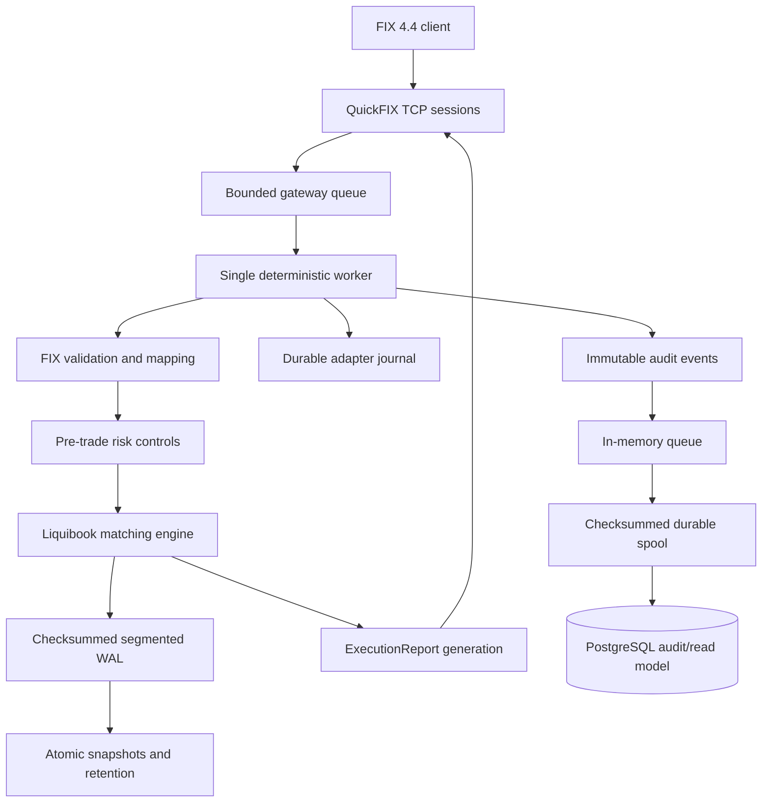

# Production-oriented exchange backend built around Liquibook

This repository turns the open-source [Liquibook matching engine](https://github.com/enewhuis/liquibook) into a reproducible, durable exchange-backend project. It adds external pre-trade risk, deterministic recovery, snapshot-aware segmented WAL, FIX 4.4 order entry, and an asynchronous PostgreSQL audit projection.

The verified endpoint is commit `85e3599`, tagged `postgres-audit-verified`. Major feature development is frozen at this point.

## Architecture



One worker owns all matching, risk, and FIX-adapter state. PostgreSQL runs behind an asynchronous boundary and never participates in the matching transaction. The snapshot and business WAL remain authoritative recovery state.

## Upstream and project contributions

| Area | Upstream Liquibook | Added in this project |
| --- | --- | --- |
| Matching | Header-only price-time order book, fills, cancels, replaces, stop and AON behavior | Reproducible CMake/Linux environment, defect diagnosis, seven independent regression cases, three verified state-update fixes |
| Risk | Application responsibility | External duplicate-ID, quantity, price, notional, projected-position, rate, and reservation controls |
| Durability | Application responsibility | Deterministic commands, checksummed WAL, durable receipts, crash recovery, atomic snapshots, segmented tail replay, safe retention |
| Networking | Application responsibility | QuickFIX 4.4 TCP gateway for GTC limit New, Cancel, and Cancel/Replace requests |
| Concurrency | Application responsibility | Bounded ingress queue, single-owner execution worker, asynchronous audit writer |
| Database | Application responsibility | PostgreSQL `orders`, `order_events`, `trades`, and `risk_events` projections with idempotent at-least-once delivery |
| Verification | Existing unit suite | GCC Debug/Release, ASan, UBSan, Clang Debug, process-kill recovery, outage tests, and paired benchmarks |

The matching-engine sources under `src` have not changed since `reproduction-verified`. Later phases are implemented as separate layers under `extensions`.

## Key measured results

| Result | Workload | Measurement |
| --- | --- | ---: |
| Snapshot-aware recovery | 10 million commands, snapshot at 99% | 4.93 s full replay to 47.72 ms snapshot plus tail |
| Recovery input reduction | Same workload | 690.01 MB to 6.96 MB; 10 million to 100,000 decoded commands |
| Durable FIX loopback | 5,000 accepted requests after warm-up | 1,044 requests/s; p50 0.93 ms; p99 1.59 ms |
| PostgreSQL outage isolation | Database offline for 10 seconds | 4,103 orders accepted; 12,309 events queued; exact final projection |
| Audit backlog recovery | PostgreSQL startup plus drain | 2.20 s; 5,594 recovered events/s |

The PostgreSQL comparison used five alternating paired trials. Median within-pair changes were `+1.88%` throughput, `+2.95%` p50 latency, and `+3.77%` p99 latency. Trial variance was high, so no performance improvement claim is made. Raw data and environment details are committed under [`results`](results).

## Verification matrix

| Build | Compiler or instrumentation | Complete result |
| --- | --- | ---: |
| Debug | GCC 13.3 | 15 of 15 CTest targets pass |
| Release | GCC 13.3 | 15 of 15 CTest targets pass |
| ASan | GCC 13.3 AddressSanitizer | 15 of 15 CTest targets pass |
| UBSan | GCC 13.3 UndefinedBehaviorSanitizer | 15 of 15 CTest targets pass |
| Clang Debug | Clang 18.1 | 15 of 15 CTest targets pass |

Focused coverage includes seven matching regressions, 30 risk cases, 30 WAL cases, 14 snapshot cases, 27 segmented-recovery cases, 40 FIX cases, and 21 PostgreSQL audit cases. Failure injection covers truncated and corrupt records, configuration mismatch, `SIGKILL`, connection termination, transaction rollback, PostgreSQL stop/start, duplicate delivery, and ordered backlog drain.

## Correctness and reliability contracts

- Rejected risk requests do not mutate Liquibook state.
- A successful FIX business response follows durable adapter intent and durable business-WAL acknowledgment.
- Recovery checks complete canonical state, including FIFO order, positions, reservations, rate windows, lifecycle history, and sequence.
- Snapshot publication completes file synchronization, atomic rename, and directory synchronization before WAL retirement.
- FIX application reporting is at least once and uses deterministic execution IDs.
- PostgreSQL delivery is at least once and uses deterministic primary keys for idempotence.
- Database failure cannot roll back, corrupt, or stop matching while local buffering remains available.
- Spool and database I/O never hold the matching producer mutex.

## Reproduce the verified endpoint

Build the layered Ubuntu 24.04 images:

```bash
docker build -t liquibook-repro:ubuntu24.04 .
docker build -f Dockerfile.diagnostics -t liquibook-diagnostics:ubuntu24.04 .
docker build -f Dockerfile.quickfix -t liquibook-quickfix:ubuntu24.04 .
docker build -f Dockerfile.postgres -t liquibook-postgres:ubuntu24.04 .
```

Run the complete five-configuration matrix:

```bash
docker run --rm -v "$PWD:/workspace" -w /workspace \
  liquibook-postgres:ubuntu24.04 bash scripts/verify_postgres.sh
```

Run the paired FIX/PostgreSQL benchmark and ten-second outage experiment:

```bash
docker run --rm -v "$PWD:/workspace" -w /workspace \
  liquibook-postgres:ubuntu24.04 python3 scripts/benchmark_postgres.py
```

Run the standalone audited gateway inside the PostgreSQL image:

```bash
pg_ctlcluster 16 main start
runuser -u postgres -- createuser root --superuser 2>/dev/null || true
runuser -u postgres -- createdb -O root audit 2>/dev/null || true

mkdir -p run/fix-sessions run/exchange
build/postgres-Release/audit_gateway \
  examples/fix/acceptor.cfg \
  run/exchange \
  "dbname=audit host=/var/run/postgresql connect_timeout=1"
```

The example accepts localhost FIX 4.4 sessions configured in [`examples/fix/acceptor.cfg`](examples/fix/acceptor.cfg). It is an integration example, not a production deployment configuration.

## Project evolution

| Phase | Verified tag | Evidence |
| --- | --- | --- |
| Upstream reproduction baseline | `reproduction-baseline` | [`docs/REPRODUCTION.md`](docs/REPRODUCTION.md) |
| Failure diagnosis and engine fixes | `reproduction-verified` | [`docs/FAILURE_ANALYSIS.md`](docs/FAILURE_ANALYSIS.md) |
| Pre-trade risk controls | `risk-controls-verified` | [`docs/RISK_CONTROLS.md`](docs/RISK_CONTROLS.md) |
| Risk profiling and optimization | `risk-controls-perf-verified` | [`docs/RISK_PERFORMANCE.md`](docs/RISK_PERFORMANCE.md) |
| WAL and crash recovery | `wal-recovery-verified` | [`docs/WAL_RECOVERY.md`](docs/WAL_RECOVERY.md) |
| Atomic snapshots | `snapshots-verified` | [`docs/SNAPSHOTS.md`](docs/SNAPSHOTS.md) |
| Direct segmented recovery | `snapshot-recovery-optimized` | [`docs/SEGMENTED_RECOVERY.md`](docs/SEGMENTED_RECOVERY.md) |
| FIX 4.4 gateway | `quickfix-gateway-verified` | [`docs/FIX_GATEWAY.md`](docs/FIX_GATEWAY.md) |
| Asynchronous PostgreSQL audit | `postgres-audit-verified` | [`docs/POSTGRES_AUDIT.md`](docs/POSTGRES_AUDIT.md) |

The consolidated design, test matrix, limitations, and measurements are in [`docs/TECHNICAL_REPORT.md`](docs/TECHNICAL_REPORT.md).

## Deliberate limits

- The FIX boundary supports GTC limit orders; unsupported IOC and market orders are explicitly rejected.
- Adapter metadata recovery scans the complete adapter journal.
- The audit spool is append only, capped at 512 MiB, and has no compaction process.
- The project is a single-node engineering prototype without replication, leader election, TLS, or a production operations layer.
- Timing results describe the committed workloads and Docker environment; they are not universal capacity claims.

## Attribution and license

Liquibook was created by its upstream maintainers and remains available from the [official repository](https://github.com/enewhuis/liquibook). The original project documentation is preserved in Git history and at the `reproduction-baseline` tag. Upstream code and this extension work remain subject to [`license.txt`](license.txt).
