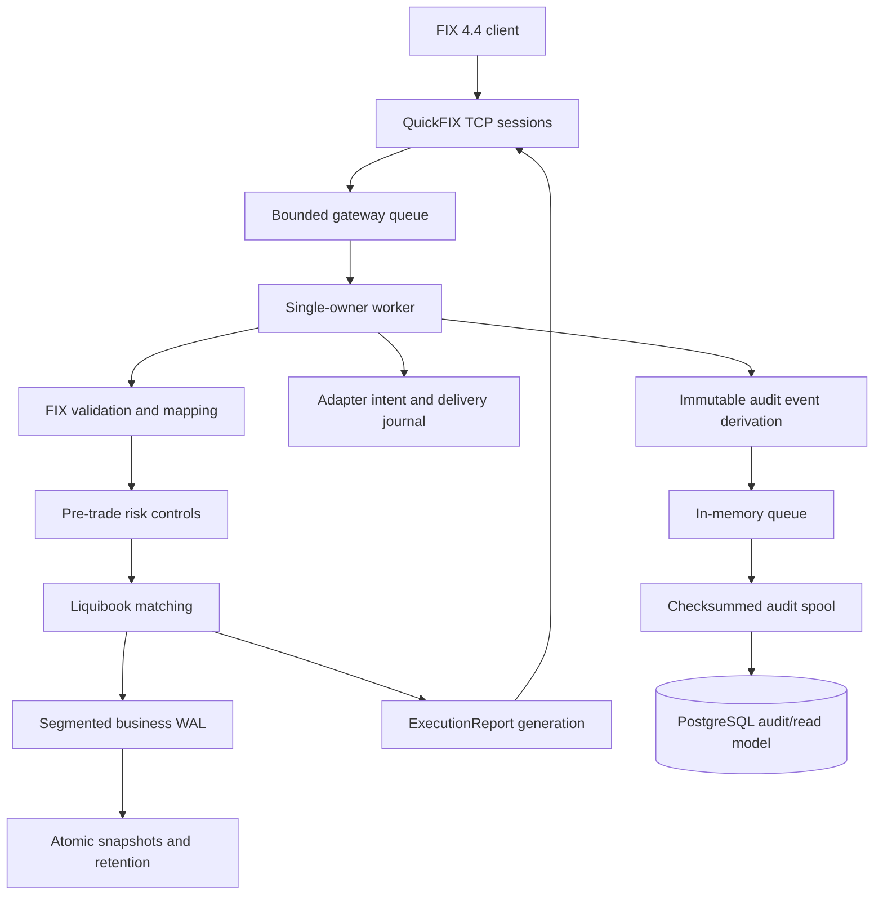

# Exchange systems project: technical report

## Scope and result

This project starts from upstream Liquibook, reproduces and diagnoses its test behavior, then adds independent exchange-system layers without moving those concerns into the matching engine. Each phase has a frozen Git endpoint and its own tests and benchmarks. No matching-engine source under `src` has changed since the verified upstream defect fixes.

The business recovery authority is the snapshot plus segmented WAL. The adapter journal reconstructs external-ID and report-delivery state. PostgreSQL is a query projection. Database loss or delay cannot change matching results.

## Phase progression

| Phase | Main result | Frozen endpoint |
| --- | --- | --- |
| Reproduction | Upstream build reproduced; all registered tests accounted for; one defective test and three genuine engine defects isolated | `reproduction-verified` |
| Risk controls | Duplicate ID, quantity, price, notional, position and rate limits outside Liquibook | `risk-controls-verified` |
| Risk profiling | Removed redundant accepted-ID registry while preserving behavior | `risk-controls-perf-verified` |
| WAL | Deterministic commands, receipts, checksums and crash recovery | `wal-recovery-verified` |
| Snapshots | Versioned atomic state images and exact tail replay | `snapshots-verified` |
| Segmented recovery | Direct snapshot anchors, WAL retention and bounded tail reads | `snapshot-recovery-optimized` |
| FIX gateway | QuickFIX 4.4 TCP order entry with durable adapter intent and at-least-once reports | `quickfix-gateway-verified` |
| PostgreSQL audit | Durable asynchronous spool and idempotent audit/read projection | `postgres-audit-verified` |

## Correctness boundaries

- One worker owns every matching, risk and adapter mutation.
- Rejected risk requests never mutate the order book.
- A successful FIX business report follows durable adapter intent and durable business-WAL acknowledgment.
- Recovery compares canonical book, position, reservation, rate-window and sequence state.
- Snapshot publication uses temporary write, file synchronization, atomic rename and directory synchronization before WAL retirement.
- FIX application reports are at least once and retain deterministic execution IDs.
- PostgreSQL delivery is at least once and uses deterministic primary keys for idempotence.
- PostgreSQL transactions update append-only events and the current order projection together.
- Audit queue, spool and database work do not perform I/O under the matching producer mutex.

## Test matrix

| Configuration | Compiler/instrumentation | Complete CTest result |
| --- | --- | --- |
| Debug | GCC 13.3 | 15 of 15 targets pass |
| Release | GCC 13.3 | 15 of 15 targets pass |
| ASan | GCC 13.3 AddressSanitizer | 15 of 15 targets pass |
| UBSan | GCC 13.3 UndefinedBehaviorSanitizer | 15 of 15 targets pass |
| Clang Debug | Clang 18.1 | 15 of 15 targets pass |

Focused suites include seven matching regressions, 30 risk cases, 30 WAL cases, 14 snapshot cases, 27 segmented-recovery cases, 40 FIX cases and 21 PostgreSQL cases. Failure injection includes truncated and corrupt records, configuration mismatch, real process kills, database connection termination, transaction rollback, full PostgreSQL stop/start, duplicate delivery, offline shutdown and ordered backlog drain.

## Selected measurements

| Question | Workload | Result |
| --- | --- | --- |
| Cost of synchronous durability | 5,000 crossing commands | No-WAL 8.82 million submissions/s; per-command fsync 3,100 durable orders/s |
| Benefit of direct snapshot anchor | 10 million commands, snapshot at 99% | 4.93 s full replay versus 47.72 ms snapshot plus tail; 10 million versus 100,000 decoded commands |
| Durable FIX path | 5,000 closed-loop loopback requests | 1,044 requests/s median, p50 0.93 ms, p99 1.59 ms at `quickfix-gateway-verified` |
| Async PostgreSQL path | Five alternating 5,000-request pairs | Median paired change: +1.88% throughput, +2.95% p50, +3.77% p99; variation is too broad for a precise overhead claim |
| PostgreSQL outage | Ten seconds offline | 4,103 accepted orders, 12,309 queued events, 2.20 s startup plus drain, exact 4,104-row projection |

The benchmark workloads answer different questions and their rates are not directly comparable. Docker VM scheduling and storage produced substantial trial variation. Raw data, hashes, byte counts and environment records are retained with each phase.

## Operational limits

- GTC limit orders only at the FIX boundary; unsupported IOC and market orders are rejected.
- FIX adapter restart reconstructs metadata from the complete adapter journal.
- The asynchronous audit spool is append only, capped at 512 MiB and has no checkpoint/retention process.
- PostgreSQL schema evolution and automatic migration are outside this phase.
- QuickFIX packaged file-store power-loss behavior and the host storage stack are not certified.
- The implementation is a single-node engineering prototype, with no replication, leader election, TLS or production operations layer.

## Reproduction entry points

- `scripts/verify_postgres.sh`: complete five-configuration build and test matrix.
- `scripts/benchmark_postgres.py`: paired FIX/PostgreSQL measurements and the ten-second outage experiment.
- `docs/FAILURE_ANALYSIS.md`: upstream failure classification and fixes.
- `docs/RISK_CONTROLS.md`: risk contract and lifecycle accounting.
- `docs/WAL_RECOVERY.md`, `docs/SNAPSHOTS.md`, `docs/SEGMENTED_RECOVERY.md`: durability and recovery design.
- `docs/FIX_GATEWAY.md`: protocol, acknowledgment and adapter recovery design.
- `docs/POSTGRES_AUDIT.md`: database schema, delivery semantics and failure behavior.
